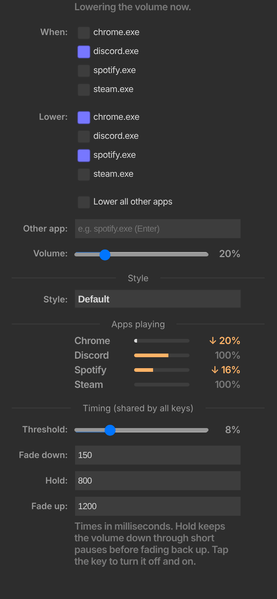

# AudioDuck

Automatic per-app volume ducking for Windows, as a Stream Deck / OpenDeck plugin. When a trigger app (say Discord)
plays sound, the apps you pick (say Spotify and Chrome) get quieter, then fade back up when it stops. Each key is
one rule, and tapping it turns the rule off and on.

Setup, key images and install steps: [streamdeck/README.md](streamdeck/README.md).
