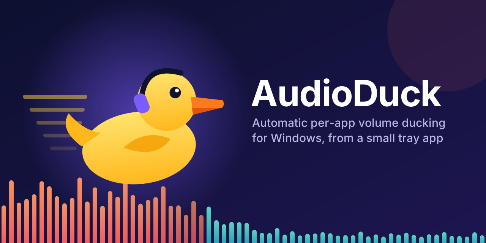
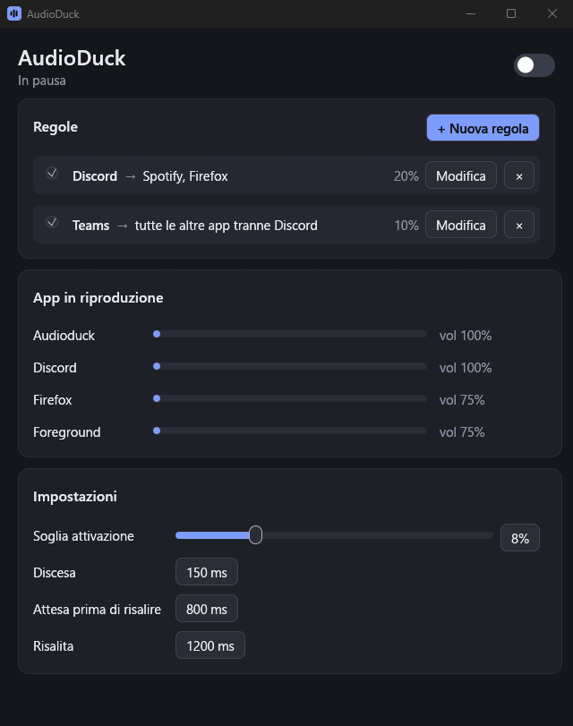

# AudioDuck

Automatic per-app volume ducking for Windows. When a trigger app (say Discord) plays sound, the apps you pick
(say Spotify and Chrome) get quieter, then fade back up when it stops. Rules, threshold and fade timings are set in
a small settings window, and AudioDuck keeps running in the tray when you close it.

Build with `cargo build --release`, then start it with `AudioDuck.bat` (`--tray` starts it hidden in the tray).

Looking for the Stream Deck / OpenDeck plugin? It lives in [audioduck-streamdeck](https://github.com/XenSide/audioduck-streamdeck).
